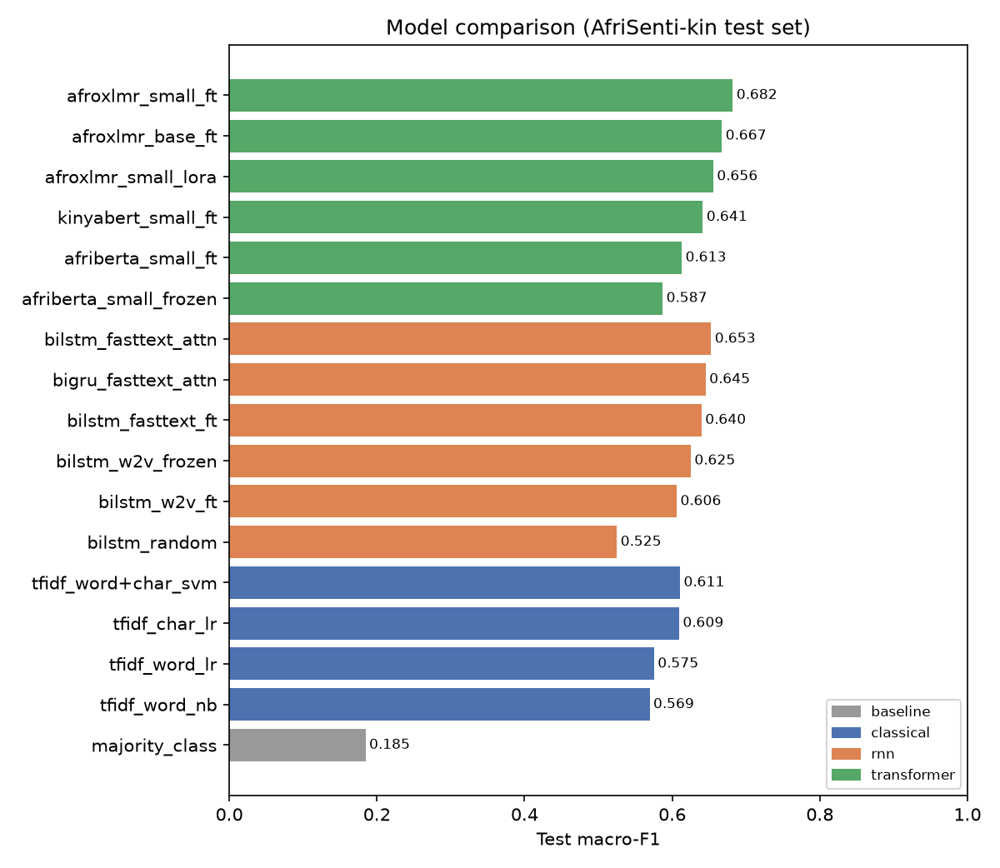

# Kinyarwanda Tweet Sentiment Classification

Three-way sentiment classification (**negative / neutral / positive**) for **Kinyarwanda** tweets. I compare
classical baselines, BiLSTM/BiGRU models on Word2Vec/FastText embeddings that I pre-trained myself, and fine-tuned
African-language Transformers (AfriBERTa, KinyaBERT, AfroXLMR, plus LoRA). The best model is deployed as a
Gradio web app.

| | Link |
|---|---|
| **Live system** | `<ADD: https://huggingface.co/spaces/<user>/kinyarwanda-sentiment>` |
| **Fine-tuned model** | `<ADD: https://huggingface.co/<user>/kinyarwanda-sentiment-afroxlmr>` |
| **Demo video** | `<ADD>` |
| **Report** | [`report/REPORT.md`](report/REPORT.md) |

---

## 1. Problem

Kinyarwanda is the national language of Rwanda and is spoken by roughly 15 million people. Most Rwandans write
on social media in Kinyarwanda, often mixed with English and French, yet very little NLP tooling exists for it.
Sentiment classification lets public-service, health and business organisations track opinion at scale. Examples
include reactions to policies, customer feedback and public-health campaigns.

**Task:** given a Kinyarwanda tweet, predict its sentiment polarity.

## 2. Dataset

| | |
|---|---|
| Labelled data | **AfriSenti-SemEval 2023, Kinyarwanda subset** (Muhammad et al., 2023), CC BY 4.0. Tweets annotated by 3 native speakers, gold label by majority vote |
| Raw sizes | train 3,302 · dev 827 · test 1,026 |
| After cleaning | train **3,191** (removed 18 conflicting-label duplicates, 34 exact duplicates, 59 tweets also present in dev/test) · dev 827 · test 1,026 (dev/test untouched) |
| Labels (train) | negative 1,098 · neutral 1,220 · positive 873 |
| Unlabelled data | **KINNEWS** (Niyongabo et al., 2020): 21k Kinyarwanda news articles, 286k sentences, 6.5M tokens. Used **only** as unlabelled text for pre-training Word2Vec/FastText (its topic labels are ignored) |
| Annotator labels | the per-annotator AfriSenti file is used to compute how many annotators agree with each gold label (for error analysis) |

Key data characteristics (`results/data_stats.json`):
- **73.6%** of the training vocabulary occurs only once.
- **26%** of test tokens never appear in training. Kinyarwanda is agglutinative, so the same root shows up in many surface forms.
- About 20% of tweets contain emojis. 😂 is the most frequent token in *negative* tweets, where it signals mockery.
- Only 30% of test tweets have unanimous annotator agreement. The rest are 2-of-3 majority labels.

No synthetic / LLM-generated data is used anywhere.

## 3. Method

| Stage | Script | What |
|---|---|---|
| Data preparation | `src/prepare_data.py`, `src/preprocess.py` | download, de-duplicate, leakage removal, two cleaning levels (light for Transformers; full = lower-case, de-elongation, emoji splitting for word models), EDA figures |
| Baselines | `src/baselines.py` | majority class; TF-IDF (word 1-2-grams / char 2-5-grams) + Naive Bayes / Logistic Regression / linear SVM, hyper-parameters tuned on dev |
| Embeddings | `src/train_embeddings.py` | Word2Vec & FastText skip-gram (100-d) trained on KINNEWS + training tweets |
| RNNs | `src/train_rnn.py` | BiLSTM / BiGRU, max+mean pooling or additive attention, random vs Word2Vec vs FastText embeddings, frozen vs fine-tuned; 3 seeds each |
| Transformers | `src/finetune_transformer.py` | full fine-tuning, frozen-encoder (linear probe) and LoRA of AfriBERTa-small, KinyaBERT-small, AfroXLMR-small, AfroXLMR-base |
| Model selection | `src/select_final.py` | best **dev** macro-F1 → `models/final` |
| Evaluation | `src/analyze.py`, `src/probes.py`, `src/tokenizer_stats.py` | experiment table, confusion matrices, bootstrap CIs, McNemar tests, sliced error analysis, behavioural/out-of-domain probes, tokenizer analysis |
| App | `app.py`, `deploy/` | Gradio interface; Hugging Face Space deployment script |

## 4. Results (test set, 1,026 tweets)

Selection was done on dev. Each test number is computed once. Full table: [`results/experiments_table.md`](results/experiments_table.md).

| Model | Test acc | Test macro-F1 | Test weighted-F1 |
|---|---:|---:|---:|
| Majority class | 0.383 | 0.185 | 0.212 |
| TF-IDF word + NB | 0.565 | 0.569 | 0.566 |
| TF-IDF char n-gram + LR (baseline) | 0.607 | 0.609 | 0.603 |
| BiLSTM, random embeddings | 0.532 | 0.525 (3-seed mean 0.512) | 0.528 |
| BiLSTM + Word2Vec (frozen) | 0.623 | 0.625 (mean 0.618) | 0.621 |
| BiLSTM + FastText + attention | 0.648 | 0.653 (mean 0.635) | 0.649 |
| AfriBERTa-small, frozen encoder | 0.589 | 0.587 | 0.588 |
| AfriBERTa-small, fine-tuned | 0.612 | 0.613 | 0.612 |
| KinyaBERT-small, fine-tuned | 0.639 | 0.641 | 0.639 |
| AfroXLMR-small, LoRA (r=16, 1.2M trainable params) | 0.653 | 0.656 | 0.653 |
| AfroXLMR-base, fine-tuned | 0.664 | 0.667 | 0.665 |
| **AfroXLMR-small, fine-tuned (final)** | **0.679** | **0.682** [95% CI 0.653–0.711] | **0.680** |

The final model is significantly better than the TF-IDF baseline and AfriBERTa (McNemar p < 0.001). It is **not**
significantly better than the best BiLSTM (p = 0.055), LoRA (p = 0.052) or AfroXLMR-base (p = 0.31). For reference, the best SemEval-2023 system reached 72.6
weighted-F1 on this test set. The report discusses this and the error analysis in detail.



## 5. Reproducing

```bash
python -m venv .venv && source .venv/bin/activate     # Windows: .venv\Scripts\activate
pip install -r requirements.txt
bash run_all.sh            # everything; Transformer runs need a GPU in practice
# or GPU part only (Colab / Kaggle):  bash cloud_gpu_runs.sh
```

Each step can also be run on its own, e.g. `cd src && python baselines.py`. All results are appended to
`results/experiments.jsonl`, and `python src/analyze.py --best afroxlmr_small_ft` rebuilds the tables and figures.

Hardware used: data, baselines, embeddings, RNNs and AfriBERTa-small ran on a CPU laptop (8 GB RAM). The other
Transformer runs used a Google Colab T4 GPU, because full fine-tuning of AfroXLMR did not fit in RAM on the laptop.

## 6. Running the web app

```bash
python app.py                 # uses models/final  ->  http://127.0.0.1:7860
MODEL_ID=<user>/kinyarwanda-sentiment-afroxlmr python app.py   # or load the model from the HF Hub
```

Deploying to a free Hugging Face Space:

```bash
huggingface-cli login                          # write token
python deploy/deploy_to_hf.py --user <hf-username>
```

This uploads `models/final` as a model repo, creates the Space (app + preprocessing + TF-IDF baseline) and sets
`MODEL_ID`. The app shows the class probabilities from the fine-tuned model, a low-confidence warning, and the
TF-IDF baseline's prediction for comparison.

## 7. Repository layout

```
app.py                     Gradio app
src/                       all pipeline code (see table in §3)
data/raw/                  AfriSenti Kinyarwanda TSVs + annotator labels (CC BY 4.0)
data/processed/            cleaned splits used by every model
data/external/             KINNEWS (downloaded automatically, not committed)
models/                    tfidf_baseline.joblib (committed); other models re-created / on HF Hub
results/                   experiments.jsonl, experiments_table.md, predictions/, figures/,
                           error_analysis.json, probes.json, examples_*.md, errors_*.csv, logs
report/REPORT.md           final report
deploy/                    Hugging Face Space deployment
```

## 8. Existing resources vs. my own work

**Used (not mine):** AfriSenti data and annotations; KINNEWS corpus; pretrained checkpoints
`Davlan/afro-xlmr-small`, `Davlan/afro-xlmr-base`, `castorini/afriberta_small`, `jean-paul/KinyaBERT-small`;
libraries PyTorch, Hugging Face Transformers & PEFT, scikit-learn, gensim, Gradio, emoji.

**Implemented in this project:** data cleaning / de-duplication / leakage removal; annotator-agreement linking;
training of the Word2Vec/FastText embeddings; the BiLSTM/BiGRU + attention classifiers (PyTorch, from scratch);
the fine-tuning loop (full, frozen, LoRA); all experiments and hyper-parameter selection; the evaluation, significance
testing, error analysis and probes; and the web app and deployment.

AI assistance (Claude) was used for coding and documentation support. I checked the results by running every
script and inspecting its outputs.

## 9. License & citation

Code: MIT. AfriSenti data: CC BY 4.0 (Muhammad et al., 2023). KINNEWS: copyright of the original news sources,
used for research only (Niyongabo et al., 2020). See the report for the full reference list.
