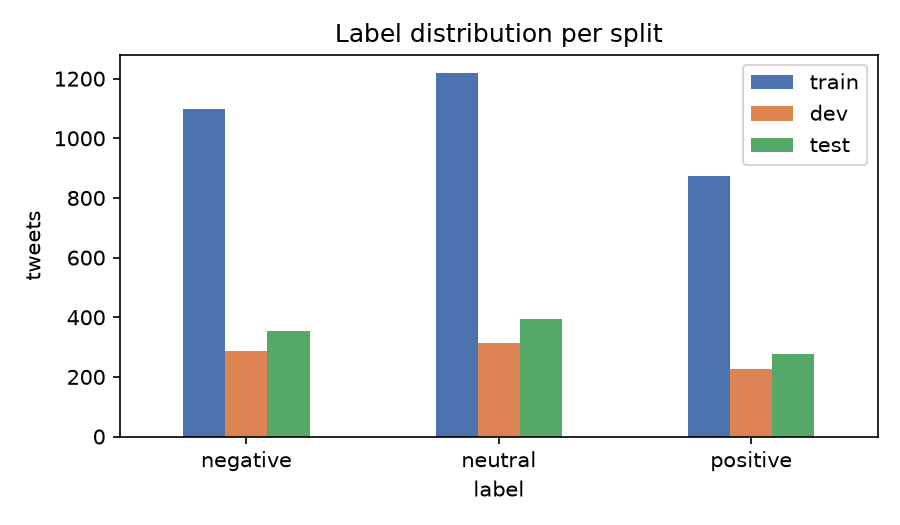
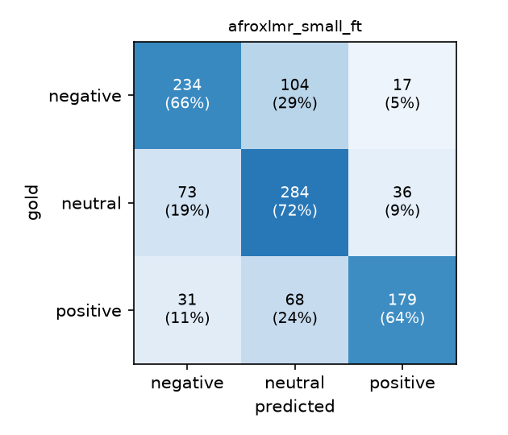
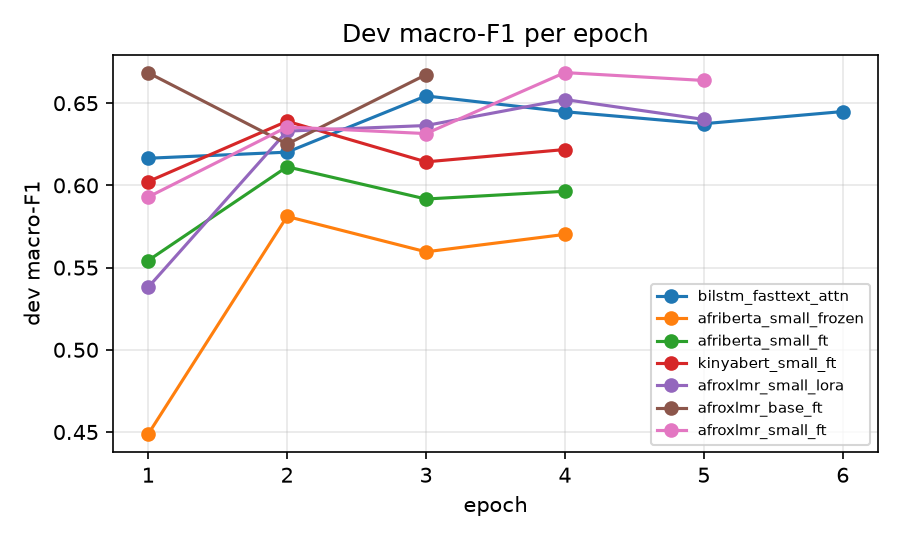

# Sentiment Classification of Kinyarwanda Tweets: From TF-IDF to African-Language Transformers

**Project type:** Text Classification for an African Language (Option 3)
**Language:** Kinyarwanda (ISO 639-3: `kin`)

**Project links**

| | |
|---|---|
| GitHub Repository | `<ADD LINK>` |
| Demo Video | `<ADD LINK>` |
| Live System | `<ADD LINK: https://huggingface.co/spaces/<user>/kinyarwanda-sentiment>` |
| Fine-tuned model | `<ADD LINK: https://huggingface.co/<user>/kinyarwanda-sentiment-afroxlmr>` |

If the live system is offline (free hosting can sleep after inactivity), it can be run locally with
`python app.py` after cloning the repository (see README §6); the demo video also shows the system in use.

---

## 1. Abstract

Sentiment analysis tools are largely unavailable for most African languages, even widely spoken ones. This project
builds a three-way (negative / neutral / positive) sentiment classifier for **Kinyarwanda tweets**. It uses the
Kinyarwanda portion of the AfriSenti-SemEval 2023 benchmark (Muhammad, Abdulmumin, Yimam et al., 2023): 5,044
human-annotated tweets after cleaning. A further 6.5 million tokens of unlabelled Kinyarwanda news text (KINNEWS;
Niyongabo et al., 2020) are used to pre-train word embeddings. I compare 17 configurations from four families:
- classical TF-IDF models;
- BiLSTM/BiGRU networks on randomly initialised, Word2Vec or FastText embeddings, with and without attention;
- pretrained Transformers (AfriBERTa, KinyaBERT, AfroXLMR) under full fine-tuning, frozen-encoder and LoRA training;
- a majority-class floor.

The best model, AfroXLMR-small with full fine-tuning, reaches **0.682 macro-F1** (95% bootstrap CI 0.653–0.711) and
**0.680 weighted-F1** on the official test set, against 0.609 for a character n-gram TF-IDF baseline. That is a
statistically significant gain (McNemar p < 0.001). However, a BiLSTM on self-trained FastText embeddings comes
within 3 points (0.653), and that difference is not significant (p = 0.055). Pre-trained representations matter far
more than architecture: initialising the BiLSTM with in-language embeddings adds 11 points.

Error analysis shows four things:
1. Accuracy falls from 81% on tweets where all three annotators agreed to 63% on 2-of-3 majority tweets.
2. Neutral tweets that use positive vocabulary (religious, greeting and campaign messages) are confidently called positive.
3. Negation and sarcasm are not handled.
4. The model is over-confident on inputs outside its domain.

The final model is deployed as a Gradio web application.

## 2. Introduction

Kinyarwanda is a Bantu language of the Great Lakes group. It is the national language of Rwanda, spoken by virtually
the whole population and by communities in Uganda and the DRC, about 15 million speakers in all (Indiana University
Center for Language Technology, n.d.). It is also mutually intelligible with Kirundi. Despite this, it is
"low-resource" in the NLP sense: little labelled data, few pretrained models, and almost no deployed tools (Joshi et al., 2020).

Social media is where much public opinion in Rwanda is expressed. That includes reactions to government
announcements, health campaigns, sport and commerce. Automatic sentiment classification lets institutions and
researchers summarise this opinion at scale. Building it for Kinyarwanda brings typical low-resource challenges:
- **Rich morphology:** Kinyarwanda is agglutinative, so one root shows up in many surface forms.
- **Informal spelling:** missing apostrophes, elongations, inconsistent word segmentation.
- **Code-mixing** with English and French.
- **Emoji-heavy, often sarcastic writing.**
- **Very little labelled data.**

**Objective.** To investigate which machine-learning approaches, from classical baselines to fine-tuned Transformers,
work best for Kinyarwanda tweet sentiment under realistic data and compute constraints; to explain *why*, through
controlled experiments and error analysis; and to deploy the best model as a usable web application.

## 3. Related Work

**Sentiment analysis for African languages.** AfriSenti (Muhammad, Abdulmumin, Ayele et al., 2023) is the first
large multilingual Twitter sentiment benchmark for African languages. It covers 14 languages, including Kinyarwanda,
with tweets annotated by native speakers. It was the basis of SemEval-2023 Task 12 (Muhammad, Abdulmumin, Yimam et
al., 2023), where systems were ranked by weighted-F1. For Kinyarwanda, the best submissions reached 72.63 (BCAI-AIR3)
and 72.50 weighted-F1 (KINLP; Nzeyimana, 2023). KINLP fine-tuned KinyaBERT, a *morphology-aware* Kinyarwanda model
(Nzeyimana & Niyongabo Rubungo, 2022). Most strong systems in the task fine-tuned multilingual or Africa-centric
pretrained Transformers, often ensembling several.

**Kinyarwanda text classification.** KINNEWS and KIRNEWS (Niyongabo et al., 2020) provide news-topic classification
datasets for Kinyarwanda and Kirundi. The authors showed that classical models with good features, and word
embeddings trained on in-language text, are competitive in this low-resource setting. MasakhaNEWS (Adelani et al.,
2023) extended news-topic classification to 16 African languages.

**Representations.** Static embeddings such as Word2Vec (Mikolov et al., 2013) learn word vectors from co-occurrence.
FastText (Bojanowski et al., 2017) represents a word as a bag of character n-grams, which helps with morphologically
rich languages and unseen words. Recurrent networks, the LSTM (Hochreiter & Schmidhuber, 1997) and the GRU (Cho et
al., 2014), combined with attention (Bahdanau et al., 2015), were the standard text classifiers before Transformers
(Vaswani et al., 2017).

Pretrained Transformer encoders, BERT (Devlin et al., 2019) and the multilingual XLM-R (Conneau et al., 2020), cover
few African languages well. AfriBERTa (Ogueji et al., 2021) was pretrained from scratch on less than 1 GB of text in 11
African languages, including "Gahuza" (Kinyarwanda + Kirundi). AfroXLMR (Alabi et al., 2022) adapts XLM-R to 17
African languages, Kinyarwanda included, through multilingual adaptive fine-tuning (MAFT). Its "small" version
removes vocabulary items unused by African languages, shrinking the vocabulary to about 70k.

Parameter-efficient fine-tuning, in particular LoRA (Hu et al., 2022), trains small low-rank updates instead of all weights.

**Gap addressed.** SemEval systems report a single leaderboard number, usually from large ensembles. Few works
compare, *on the same data*:
- classical models, RNNs and Transformers;
- how much each component contributes (in-language embeddings, subword information, attention, fine-tuning strategy);
- what kinds of errors remain, using the per-annotator labels.

This project provides such a controlled comparison under modest compute, together with a deployed tool.

## 4. Dataset and Data Preparation

### 4.1 Sources

| Resource | Use | Size | License |
|---|---|---|---|
| AfriSenti-SemEval 2023, Kinyarwanda (`data/kin/{train,dev,test}.tsv`) | labelled train / dev / test | 3,302 / 827 / 1,026 tweets | CC BY 4.0 |
| AfriSenti per-annotator labels (`kinyarwanda_individual_labels.csv`) | annotator-agreement analysis only | 6,001 tweets × 3 annotators | CC BY 4.0 |
| KINNEWS (raw train + test) | **unlabelled** text for embedding pre-training, and an out-of-domain probe | 21,268 articles → 286,665 sentences, 6.49M tokens | copyright of news sources; research use |

AfriSenti tweets were collected from Twitter and then annotated by three native speakers
each. The gold label is the majority vote (Muhammad, Abdulmumin, Ayele et al., 2023). This is real, naturally
occurring data, which is what the task needs. It is also the official SemEval benchmark, so results can be compared
with published systems. **No synthetic or LLM-generated data was used.**

### 4.2 Characteristics (from `results/data_stats.json`)

- **Labels:** the classes are mildly imbalanced (train: 34% negative, 38% neutral, 27% positive). The class mix is similar in every split.
- **Length:** tweets are short, 13.5 tokens on average after cleaning, so the maximum sequence length was set to 96 subwords.
- **Sparse, morphology-driven vocabulary:** the training vocabulary has 15,356 types and **73.6% occur only once**.
  **26.3% of test tokens** never appear in training. This sparsity is the central difficulty for word-level models.
- **Emojis:** about 20% of tweets contain them. 😂 and 🤣 are the *most frequent tokens in negative tweets*, where they mark mockery rather than joy.
- **Label ambiguity:** of the 958 test tweets matched to the annotator file, only 287 (30%) were labelled
  unanimously. 662 (69%) have a 2-of-3 majority, and 9 have one or no annotator agreeing with the released gold label.

### 4.3 Preprocessing (`src/preprocess.py`, `src/prepare_data.py`)

The tweets were already anonymised (`@user`). I implemented two cleaning levels. The deployed app imports the same
functions, so training and inference preprocessing are identical.

- **Light cleaning (Transformers):** remove URLs; collapse runs of `@user` mentions into one; strip `#` from hashtags
  but keep the word; unescape HTML entities. Case, punctuation and emojis are kept, because the subword tokenizers
  can represent them and they carry sentiment.
- **Full cleaning (TF-IDF, Word2Vec, RNNs):** light cleaning, then:
  - lower-case and remove mentions;
  - normalise apostrophes (`’` → `'`); apostrophes inside words are kept because they are meaningful in Kinyarwanda, as in *n'umugore*;
  - reduce elongations of 3+ repeated characters to 2 (*byizaaaa* → *byizaa*);
  - make every emoji its own token;
  - remove other punctuation and replace numbers with `<num>`.

**Cleaning the training split.** Dev and test were left untouched, to stay comparable with SemEval:
- removed 18 tweets whose text appears more than once with *different* labels;
- removed 34 exact duplicates;
- removed **59 training tweets that also occur in dev or test**, which would otherwise leak test information.

This leaves 3,191 training tweets.

**Annotator agreement.** Each tweet was linked to its three individual annotations by matching normalised text
(the annotation file keeps real @handles; the release replaces them with `@user`, and light cleaning maps both to the
same string). This gives an agreement score of 0–3 per tweet, which is used only in the error analysis.

**Splits.** I used the official train / dev / test splits. All model selection, including hyper-parameters, epochs
and the final model, was done on **dev**. The test set was used only for the final reported numbers.

## 5. Methodology

### 5.1 Baselines (`src/baselines.py`)

- **Majority class:** always predicts *neutral*. This is the floor.
- **TF-IDF + linear models:**
  - word 1–2-grams with Multinomial Naive Bayes or Logistic Regression;
  - character 2–5-grams (within word boundaries) with Logistic Regression;
  - word + character features with a linear SVM.

  All use sublinear TF and class-balanced weights. The regularisation strength (C or α) was selected on dev from a
  small grid. Character n-grams are a natural baseline for an agglutinative language, because they share evidence
  between inflected forms of the same root.

### 5.2 Static embeddings (`src/train_embeddings.py`)

Both models use skip-gram, 100 dimensions, window 5, min_count 2 and 5 epochs, trained with gensim (Řehůřek & Sojka, 2010):
- Word2Vec (Mikolov et al., 2013);
- FastText with character n-grams of length 3–6 (Bojanowski et al., 2017).

The training corpus is KINNEWS plus the training tweets, with the tweets repeated 3× to up-weight in-domain usage.
Dev and test tweets were never used. The vocabulary has 120,466 words.

A qualitative check: FastText maps the unseen elongated form *nibyizaaa* to *nibyiza* ("it is good"), *ibyiza* and
*sibyiza*. This shows why subword information matters for noisy tweets.

### 5.3 Recurrent classifiers (`src/train_rnn.py`)

The architecture, implemented from scratch in PyTorch (Paszke et al., 2019):
1. Embedding layer (100-d).
2. Dropout 0.4.
3. One bidirectional LSTM or GRU layer (128 units per direction), with packed sequences.
4. Pooling over time, either:
   - concatenated max and mean pooling, or
   - additive (Bahdanau-style) attention: score_t = vᵀ tanh(W h_t), with weights α = softmax(score) over non-padding positions.
5. Dropout, then a linear layer over the 3 classes.

Training: Adam (lr 1e-3), cross-entropy, batch 32, gradient clipping at 1.0, up to 15 epochs, early stopping on dev
macro-F1 (patience 3).

Embedding variants:
- **random:** vocabulary from training tweets only;
- **Word2Vec, frozen or fine-tuned;**
- **FastText, fine-tuned.** For FastText, the vocabulary also includes dev and test tokens, whose vectors are
  *composed from character n-grams* of the pretrained model. This uses no labels. It is equivalent to computing
  FastText vectors on the fly at inference, because those rows receive no gradient.

Each configuration was trained with **3 seeds**. I report the mean ± std, plus the run with the best dev score.

### 5.4 Transformer fine-tuning (`src/finetune_transformer.py`)

| Checkpoint | Layers / hidden | Params | Pretraining relevant to Kinyarwanda |
|---|---|---|---|
| `castorini/afriberta_small` (Ogueji et al., 2021) | 4 / 768 | 83M | from scratch on 11 African languages incl. Gahuza |
| `jean-paul/KinyaBERT-small` (HF model card) | 6 / 768 | 67M | BERT, Kinyarwanda only (news, Wikipedia, books), uncased |
| `Davlan/afro-xlmr-small` (Alabi et al., 2022) | 12 / 768 | 140M | XLM-R + MAFT on 17 African languages incl. Kinyarwanda; 70k vocab |
| `Davlan/afro-xlmr-base` (Alabi et al., 2022) | 12 / 768 | 278M | same, full 250k XLM-R vocab |

I wrote a plain PyTorch training loop on Hugging Face Transformers (Wolf et al., 2020), with the standard sequence
classification head (first-token representation → dense → tanh → linear):
- AdamW, weight decay 0.01, batch 16, linear warm-up (10%) and decay;
- gradient clipping at 1.0;
- early stopping on dev macro-F1 (patience 2), restoring the best checkpoint;
- max length 96;
- learning rates chosen per model size: 5e-5 for the small 4–6-layer models, 3e-5 for AfroXLMR-small, 2e-5 for
  AfroXLMR-base; 1e-3 for the frozen encoder and 5e-4 for LoRA.

Three training strategies were compared:
1. **Full fine-tuning:** all weights are updated.
2. **Frozen encoder (linear probe):** only the classification head is trained. This measures how sentiment-ready the
   pretrained representations already are.
3. **LoRA** (Hu et al., 2022), using PEFT (Mangrulkar et al., 2022): rank-16 adapters (α = 32, dropout 0.1) on the
   attention query and value projections, plus a trainable head. That is 1.18M trainable parameters, 0.84% of the model.

**Compute.** Data preparation, baselines, embeddings, RNNs and AfriBERTa-small were run on a CPU laptop with 8 GB of
RAM. Full fine-tuning of AfroXLMR needs about 2.5 GB just for weights, gradients and Adam state. On the laptop this
caused heavy swapping, so the remaining Transformer runs were done on a Google Colab T4 GPU (`cloud_gpu_runs.sh`).

### 5.5 Evaluation protocol (`src/analyze.py`)

- **Primary metric:** macro-F1, which treats the three classes equally.
- **Also reported:** accuracy, macro precision and recall, and weighted-F1 (the official SemEval metric).
- **Uncertainty:** 95% bootstrap confidence intervals for macro-F1 (2,000 resamples; Efron & Tibshirani, 1993).
- **Paired significance:** McNemar's exact test on per-tweet correctness (McNemar, 1947; Dietterich, 1998).
- **Error analysis:** accuracy on slices by annotator agreement, emoji, out-of-vocabulary (OOV) rate, length,
  negation and confidence.
- **Behavioural probes:** hand-written test sentences in the spirit of CheckList (Ribeiro et al., 2020), plus
  out-of-domain inputs (`src/probes.py`).

## 6. Experiments and Results

### 6.1 Main results

All numbers are on the official AfriSenti-kin **test** set (1,026 tweets). Configurations were chosen on dev.

| # | Experiment | Configuration | Dev macro-F1 | Test acc | Test macro-P | Test macro-R | **Test macro-F1** | Test weighted-F1 |
|---|---|---|---:|---:|---:|---:|---:|---:|
| 1 | Majority class | always *neutral* | 0.184 | 0.383 | 0.128 | 0.333 | 0.185 | 0.212 |
| 2 | TF-IDF word + NB | 1–2-grams, α = 0.1 | 0.593 | 0.565 | 0.580 | 0.564 | 0.569 | 0.566 |
| 3 | TF-IDF word + LR | 1–2-grams, C = 5 | 0.587 | 0.570 | 0.577 | 0.575 | 0.575 | 0.570 |
| 4 | **TF-IDF char + LR (baseline)** | char 2–5-grams, C = 1 | 0.632 | 0.607 | 0.610 | 0.618 | **0.609** | 0.603 |
| 5 | TF-IDF word+char + SVM | C = 0.05 | 0.643 | 0.607 | 0.613 | 0.614 | 0.611 | 0.605 |
| 6 | BiLSTM, random emb. | max+mean pool | 0.563 | 0.532 | 0.580 | 0.516 | 0.525 (0.512 ± 0.022) | 0.528 |
| 7 | BiLSTM + Word2Vec, fine-tuned | max+mean | 0.647 | 0.602 | 0.612 | 0.605 | 0.606 (0.618 ± 0.009) | 0.602 |
| 8 | BiLSTM + Word2Vec, frozen | max+mean | 0.659 | 0.623 | 0.628 | 0.626 | 0.625 (0.618 ± 0.011) | 0.621 |
| 9 | BiLSTM + FastText | max+mean | 0.661 | 0.637 | 0.654 | 0.635 | 0.640 (0.630 ± 0.007) | 0.636 |
| 10 | BiGRU + FastText | attention | 0.661 | 0.641 | 0.658 | 0.642 | 0.645 (0.635 ± 0.008) | 0.641 |
| 11 | **BiLSTM + FastText** | attention | 0.654 | 0.648 | 0.677 | 0.645 | **0.653** (0.635 ± 0.013) | 0.649 |
| 12 | AfriBERTa-small | frozen encoder (0.59M trainable) | 0.581 | 0.589 | 0.594 | 0.584 | 0.587 | 0.588 |
| 13 | AfriBERTa-small | full fine-tune | 0.611 | 0.612 | 0.626 | 0.607 | 0.613 | 0.612 |
| 14 | KinyaBERT-small | full fine-tune | 0.639 | 0.639 | 0.643 | 0.645 | 0.641 | 0.639 |
| 15 | AfroXLMR-small | LoRA r = 16 (1.18M trainable) | 0.652 | 0.653 | 0.658 | 0.657 | 0.656 | 0.653 |
| 16 | AfroXLMR-base | full fine-tune (278M) | 0.669 | 0.664 | 0.678 | 0.661 | 0.667 | 0.665 |
| 17 | **AfroXLMR-small (final)** | full fine-tune (140M) | **0.669** | **0.679** | **0.696** | **0.675** | **0.682** | **0.680** |

Values in parentheses are the mean ± std of test macro-F1 over 3 seeds. Source: `results/experiments_table.md`
and `results/experiments.jsonl`.

**Statistical comparison of the final model (#17)** (`results/error_analysis.json`):

| Compared with | #17 right, other wrong | #17 wrong, other right | McNemar p |
|---|---:|---:|---:|
| TF-IDF char + LR (#4) | 173 | 99 | **< 0.001** |
| AfriBERTa-small (#13) | 164 | 95 | **< 0.001** |
| KinyaBERT-small (#14) | 162 | 121 | **0.017** |
| BiLSTM + FastText + attn (#11) | 147 | 115 | 0.055 |
| AfroXLMR-small LoRA (#15) | 103 | 76 | 0.052 |
| AfroXLMR-base (#16) | 115 | 99 | 0.305 |

The 95% bootstrap CI for #17 is [0.653, 0.711]. For the baseline (#4) it is [0.580, 0.639], and for the BiLSTM (#11) [0.623, 0.681].

**Model selection.** AfroXLMR-small (#17) and AfroXLMR-base (#16) tie on dev (0.6686 vs 0.6685). The automatic
selection script (`src/select_final.py`) picked #17. It is also half the size and faster at inference, which matters
for free CPU hosting.

**Per-class results of the final model (test):**

| Class | Precision | Recall | F1 |
|---|---:|---:|---:|
| negative | 0.692 | 0.659 | 0.675 |
| neutral | 0.623 | 0.723 | 0.669 |
| positive | 0.772 | 0.644 | 0.702 |

### 6.2 What the experiments show

1. **Characters beat words for classical models (#3 vs #4: +3.4 F1).** Word n-grams treat *ndishimye*,
   *twishimye* and *barishimye* (I / we / they are happy) as unrelated features. Character n-grams share the root
   *-ishim-*. With 73.6% of word types appearing only once, this sharing is decisive. Adding word features to
   character features with an SVM (#5) adds nothing on test.

2. **Without pre-training, a neural network is worse than TF-IDF (#6: 0.512 mean).** A randomly initialised BiLSTM
   has to learn 15k word embeddings from 3.2k short tweets, most of which it sees once. It overfits within 5–6 epochs
   and is unstable across seeds (std 0.022).

3. **In-language embeddings add 11 points (#6 → #8, seed means 0.512 → 0.618).** Word2Vec trained on 6.5M tokens of
   *unlabelled* Kinyarwanda news gives the network general lexical knowledge. Freezing and fine-tuning Word2Vec give
   the same mean (0.618). With so little labelled data, updating 12M embedding parameters brings no benefit.

4. **Subword embeddings help further (#8 → #9: +1.2 mean).** FastText also covers the 26% of test tokens that are
   OOV, by composing their vectors from character n-grams.

5. **Attention vs max+mean pooling, LSTM vs GRU: differences are within seed noise** (#9–#11: 0.630–0.635 ± ~0.01).
   For short tweets, the pooling choice matters little. The single best run (#11, 0.653) is partly a lucky seed
   (mean 0.635), so I treat the RNN family's realistic level as about 0.635.

6. **Not all pretrained Transformers beat a good BiLSTM.**
   - **AfriBERTa-small (#13, 0.613)** only matches TF-IDF. It has just 4 layers and was pretrained on less than 1 GB
     of mostly formal text, where Kinyarwanda appears only inside the mixed "Gahuza" data (Ogueji et al., 2021).
     The frozen-encoder probe (#12, 0.587) shows its representations are not sentiment-ready, and fine-tuning adds only 2.6 points.
   - **KinyaBERT-small (#14, 0.641)** is monolingual Kinyarwanda, yet it falls short of AfroXLMR. The tokenizer
     analysis (`results/tokenizer_stats.json`) explains part of this: **8.9% of all tweet tokens become `[UNK]`**.
     Its 30k WordPiece vocabulary lacks emojis and even common punctuation such as `!` and `-`, so the 😂 / 🙏 / 🇷🇼
     signals are erased. It also overfits fast: training loss falls to 0.06 by epoch 4 while dev F1 declines.
   - **AfroXLMR-small (#17, 0.682)** is best. It inherits XLM-R's large multilingual web pretraining (Conneau et al., 2020)
     and was further adapted to Kinyarwanda (Alabi et al., 2022). Its SentencePiece vocabulary covers every emoji and symbol in
     the training tweets (0% `[UNK]`), even though it cuts Kinyarwanda into more pieces (2.94 subwords per word vs 2.14 for AfriBERTa).

7. **Bigger was not better (#16 vs #17).** AfroXLMR-base (278M) peaked after a single epoch, dipped, and was nearly back at that level when early stopping (patience 2) ended training at epoch 3, so a longer schedule might have helped it slightly.
   The two models are statistically indistinguishable (p = 0.31). With 3k training examples the small model's
   capacity is enough. The extra parameters of the base model sit mainly in its 250k-token embedding matrix, which
   does not help on Kinyarwanda tweets.

8. **LoRA is a strong, cheap alternative (#15).** Training 0.84% of the parameters gives 0.656. That is 2.6 points
   below full fine-tuning (not significant, p = 0.052), yet above every classical and RNN model. Its training loss
   stays much higher (0.64 vs 0.33 at the last epoch), so LoRA is *less able to fit* the training data. That limits
   overfitting but also limits accuracy. LoRA was also the only approach whose memory footprint fit the 8 GB laptop
   for a 12-layer model, and the adapter is about 5 MB instead of 540 MB.

9. **Comparison with the literature.** The final model's 68.0 weighted-F1 is 4.6 points below the best SemEval-2023
   Kinyarwanda system (72.63) and KINLP (72.50; Nzeyimana, 2023). Those systems used larger or morphology-aware
   models (the original KinyaBERT of Nzeyimana & Niyongabo Rubungo, 2022, which is different from the
   `jean-paul/KinyaBERT-small` checkpoint used here), ensembles and more tuning. This project used single runs of
   ≤278M-parameter models chosen to fit a student compute budget.

**Caveat on variance.** Transformer runs used one seed each (because of the GPU budget). The RNN seeds show std of
about 0.01, and the bootstrap CI half-width is about 0.03. Differences under about 2 points should therefore not be
over-interpreted.

## 7. Error Analysis and Discussion

The final model makes 329 errors out of 1,026. 230 of them (70%) are also made by the TF-IDF baseline, so most
errors are "hard" tweets rather than model-specific quirks. The dominant confusions are:
- negative → neutral: 104;
- neutral → negative: 73;
- positive → neutral: 68.

Positive and negative are rarely confused with each other (31 + 17). Errors are therefore mostly about *intensity
and implicitness*, not polarity reversal.

### 7.1 Sliced accuracy (`results/error_analysis.json`)

| Slice | n | Final model | TF-IDF baseline | BiLSTM+FastText |
|---|---:|---:|---:|---:|
| All tweets | 1,026 | 0.679 | 0.607 | 0.648 |
| 3/3 annotators agree | 287 | **0.808** | 0.721 | 0.774 |
| 2/3 annotators agree | 662 | **0.634** | 0.562 | 0.607 |
| contains 😂/🤣/😅/😆 | 138 | 0.645 | 0.623 | 0.616 |
| contains negation (*nta-, nti-, ntabwo, si*) | 160 | 0.638 | 0.588 | 0.600 |
| OOV rate < 20% | 327 | 0.694 | 0.624 | 0.664 |
| OOV rate ≥ 50% | 73 | 0.658 | **0.480** | 0.589 |
| length > 15 tokens | 370 | 0.705 | 0.643 | 0.670 |
| length 6–15 tokens | 600 | 0.663 | 0.583 | 0.638 |

### 7.2 Error types

**(a) Label ambiguity and annotator disagreement.** This is the largest single factor. Every model loses 15–18
accuracy points on tweets where one of three native speakers disagreed. Many of the most "confident mistakes" are
tweets with a 2/3 majority label. For example, *"@user @user Nawe singushira amakenga uroye!"* is gold *negative*
with 2/3 agreement, and the model predicts positive at 0.98. Part of the remaining error is therefore an
upper-bound effect of the data rather than a model failure. This matches the AfriSenti authors' observation that
sentiment annotation is inherently subjective (Muhammad, Abdulmumin, Ayele et al., 2023).

**(b) Neutral tweets written in positive vocabulary → predicted positive.** Several of the most confident errors are
Bible verses, greetings, campaign or public-service messages labelled *neutral*:
- *"Imig 3:5 Wiringire Uwiteka n'umutima wawe wose…"* (Proverbs 3:5, "Trust in the Lord with all your heart"): gold neutral, predicted positive, 0.99.
- *"#Babyeyi, Konsa umwana wawe neza n'ingenzi…"* (breastfeeding campaign): gold neutral, predicted positive, 0.99.

Annotators treated these as informational. The model reacts to the positive words (*Imana*, *neza*, *amahoro*) that
dominate genuinely positive tweets. Religious and greeting language is very frequent in Rwandan Twitter, so the
lexical cue is strong but misleading.

**(c) Laughing emojis and mockery.** In this data, 😂 is the most frequent token in *negative* tweets. It signals
ridicule or bitter humour, for example *"Imibare nubundi yatuzonze kuva kera 😂😂😂😂😂"* ("Mathematics has troubled
us for ages"): gold negative, predicted neutral. Accuracy is 4 points lower on tweets with laughing emojis (0.645 vs
0.685). This is consistent with the well-known difficulty of sarcasm in sentiment analysis.

**(d) Implicit or rhetorical negativity.** Questions and complaints without explicit sentiment words are labelled
neutral. Example: *"Ase Yago na Phil Peter bigeze he? Ka kana karacyiriza nka mbere?"* ("What happened to Yago and
Phil Peter? Is that kid still crying like before?"): gold negative, predicted neutral, 0.97. This drives the large
negative → neutral cell (29% of negative tweets).

**(e) Negation.** Kinyarwanda marks negation morphologically (prefixes *nti-/ntu-/nta-*, the particle *si*, the
auxiliary *ntabwo*). The model is 4 points worse on tweets with negation. The behavioural probes show the failure
directly:

| Probe (author-written, not training data) | Meaning | Intended | Predicted (conf.) |
|---|---|---|---|
| Ntabwo nishimiye ibyo wakoze | I am not pleased with what you did | negative | **positive (0.94)** |
| Ntabwo ari byiza | It is not good | negative | **positive (0.70)** |
| Si bibi na gato | It is not bad at all | positive | **negative (0.48)** |
| Wowe uri umuhanga pe 😂😂 | You are *so* clever 😂😂 (mocking) | negative | positive (0.44) |
| Ni byiza cyane kubura amazi iminsi itatu 🙄 | It's great to have no water for three days 🙄 | negative | neutral (0.65) |
| Ndishimye cyane uyu munsi | I am very happy today | positive | positive (0.98) |
| Inama izaba ejo saa tatu za mu gitondo | The meeting will be tomorrow at 9 a.m. | neutral | neutral (0.96) |
| Iyi serivisi ni mbi cyane | This service is very bad | negative | neutral (0.63) |

Explicit positive and neutral sentences are handled well: 10 of the 12 "plain" probes are correct. All 3 negation
probes and both sarcasm probes fail. The model has learned that the root *-ishim-* ("be pleased") means positive.
Negated forms like *nishimiye* under *ntabwo* are probably too rare in 3.2k tweets for it to learn that negation
flips polarity.

**(f) Out-of-vocabulary words and spelling variation.** Subword models degrade gracefully as the OOV rate rises
(0.694 → 0.658). The word-feature TF-IDF baseline collapses to 0.480 on tweets where at least half of the words are
unseen. This confirms the value of subword and character representations for Kinyarwanda's morphology and noisy spelling.

### 7.3 Confidence and out-of-domain behaviour

**Calibration.** The fine-tuned Transformer is over-confident, a known property of modern neural networks (Guo et
al., 2017):
- 49% of test predictions have confidence ≥ 0.9, but only 80.5% of those are correct;
- predictions with confidence 0.5–0.7 are right only 46% of the time.

The TF-IDF model is the opposite: under-confident, with 85.5% accuracy in its 0.7–0.9 band. The app therefore shows
a low-confidence warning below 0.55. Calibration (e.g. temperature scaling) is listed as future work.

**Out-of-domain inputs** (`results/probes.json`):
- **News headlines (KINNEWS, 300 samples):** 83% are predicted *neutral*, with mean confidence 0.86. The model
  behaves sensibly on formal news, a different register. Sad news such as *"Umurambo w'umugabo wasanzwe mu modoka"*
  ("A man's body was found in a car") is called neutral (0.72), which is arguably right for reporting style.
- **Other languages:** English *"I love this so much"*, French *"Je suis très content"* and Swahili *"Nimefurahi
  sana"* are all predicted positive with ≥ 0.95 confidence. This is cross-lingual transfer from multilingual
  pretraining, and useful for code-mixed tweets. But the model does not "know" it is outside Kinyarwanda.
- **Nonsense** (*"asdf qwerty zxcv"*) is predicted neutral with 0.95 confidence. **Confidence is therefore not a
  reliable out-of-domain detector.** A language-identification step would be needed in production.

### 7.4 Summary of the discussion

The ranking *in-language pretraining ≫ architecture* agrees with earlier work. Niyongabo et al. (2020) found that
in-language embeddings mattered for Kinyarwanda news classification, and Alabi et al. (2022) found that adapting
multilingual models to African languages beats both from-scratch small models and unadapted ones. What remains is
mostly:
- annotation subjectivity;
- pragmatic phenomena (sarcasm, mocking emojis, rhetorical questions);
- negation, which needs either more data or explicit morphological knowledge. That is the motivation behind the
  morphology-aware KinyaBERT used by the second-placed SemEval system (Nzeyimana, 2023).

## 8. Deployment

The final model is served by a **Gradio** (Abid et al., 2019) web application (`app.py`):
- The user types or pastes Kinyarwanda text, or clicks one of the example sentences.
- The app applies the *same* `light_clean` preprocessing used in training and runs the fine-tuned AfroXLMR-small.
- It displays the probabilities of the three classes, a textual verdict, a low-confidence warning, and the TF-IDF
  baseline's prediction for comparison.

On a laptop CPU, one prediction takes about 40 ms (including the baseline).

**Hosting.** `deploy/deploy_to_hf.py` handles the Hugging Face deployment:
1. It uploads the model (540 MB) to the Hugging Face Hub as a model repository.
2. It creates a free CPU Hugging Face Space containing the app, the preprocessing module and the 1.3 MB TF-IDF model.
3. It sets the Space variable `MODEL_ID`, so the app downloads the model from the Hub at start-up.

The link is given at the top of this report. Free Spaces sleep after inactivity; the first request after sleeping
takes about a minute to wake the Space. The app also runs locally with `python app.py`.

## 9. Limitations and Future Work

**Data**
- Only 3.2k training tweets, with substantial annotator disagreement (69% of test labels are 2-of-3 majorities).
- The data comes from one platform and period, so drift in topics and slang is likely.
- Embeddings were pre-trained on news text, a different register from tweets. A Kinyarwanda social-media corpus would
  probably help more.

**Model**
- No explicit handling of negation, sarcasm or morphology.
- Over-confident probabilities.
- No language identification for out-of-domain inputs.

**Evaluation**
- Transformer results are single-seed.
- Hyper-parameter search was minimal (one learning rate per model).
- The behavioural probe set is small (19 sentences) and was written by the author, so it illustrates failure modes
  but is not a statistically reliable benchmark.
- The code-mixing slice is too small (12 tweets) to draw conclusions from.

**Future work, with more time, data or compute:**
1. Multi-seed runs and learning-rate sweeps; AfroXLMR-large (Alabi et al., 2022) and the morphology-aware KinyaBERT.
2. Training with soft labels from the three annotators, rather than the majority vote, to model ambiguity.
3. Targeted data augmentation or contrast sets for negation and sarcasm, built by native speakers.
4. Temperature scaling for calibration, and a language-ID filter in the app.
5. Continued pre-training on Kinyarwanda social-media text.
6. Ensembling the Transformer with the FastText BiLSTM. Their errors overlap only partly: each is right where the
   other is wrong on 115–147 tweets.

## 10. Conclusion

I built and deployed a Kinyarwanda tweet sentiment classifier. I also compared 17 models across classical, recurrent
and Transformer approaches on the official AfriSenti benchmark. The fine-tuned AfroXLMR-small model reaches 0.682
macro-F1 / 0.680 weighted-F1, about 7 points above a strong character n-gram baseline.

The most important lessons are four:
1. **Pre-trained, in-language representations matter much more than architecture.** Word2Vec/FastText trained on
   unlabelled news turned a failing BiLSTM into a competitive one. An Africa-adapted multilingual Transformer gave the best results.
2. **A model built for Kinyarwanda is not automatically better.** Tokenizer coverage of emojis and punctuation, and
   the domain of the pretraining data, can matter more than whether the model is monolingual.
3. **Larger models and full fine-tuning give diminishing returns** at this data size. LoRA gets within 3 points
   while training under 1% of the weights.
4. **The remaining errors are largely about meaning in context:** annotator disagreement, sarcastic emojis,
   rhetorical questions and negation. Progress therefore depends as much on better data and linguistic knowledge
   as on bigger models.

### Existing resources used vs. my own work

| Used (existing) | Implemented in this project |
|---|---|
| AfriSenti-SemEval Kinyarwanda data and annotator labels; KINNEWS corpus | data cleaning, de-duplication, leakage removal, annotator-agreement linking, EDA |
| Pretrained checkpoints: AfroXLMR-small/base, AfriBERTa-small, KinyaBERT-small | Word2Vec/FastText training on KINNEWS + tweets |
| Libraries: PyTorch, Transformers, PEFT, scikit-learn, gensim, Gradio, emoji | BiLSTM/BiGRU + attention classifiers (from scratch); fine-tuning loop (full, frozen, LoRA); all 17 experiments |
| | evaluation: bootstrap CIs, McNemar tests, sliced error analysis, tokenizer analysis, behavioural/OOD probes |
| | Gradio app and Hugging Face deployment scripts |

AI assistance (Claude, Anthropic) was used for coding and drafting support. I ran, checked and interpreted every
experiment and result reported here.

## 11. References

Abid, A., Abdalla, A., Abid, A., Khan, D., Alfozan, A., & Zou, J. (2019). *Gradio: Hassle-free sharing and testing of ML models in the wild*. arXiv:1906.02569.

Adelani, D. I., Masiak, M., Azime, I. A., Alabi, J. O., Tonja, A. L., Mwase, C., et al. (2023). MasakhaNEWS: News topic classification for African languages. In *Proceedings of IJCNLP-AACL 2023*. Association for Computational Linguistics.

Alabi, J. O., Adelani, D. I., Mosbach, M., & Klakow, D. (2022). Adapting pre-trained language models to African languages via multilingual adaptive fine-tuning. In *Proceedings of the 29th International Conference on Computational Linguistics (COLING 2022)* (pp. 4336–4349).

Bahdanau, D., Cho, K., & Bengio, Y. (2015). Neural machine translation by jointly learning to align and translate. In *International Conference on Learning Representations (ICLR)*.

Bojanowski, P., Grave, E., Joulin, A., & Mikolov, T. (2017). Enriching word vectors with subword information. *Transactions of the Association for Computational Linguistics, 5*, 135–146.

Cho, K., van Merriënboer, B., Gulcehre, C., Bahdanau, D., Bougares, F., Schwenk, H., & Bengio, Y. (2014). Learning phrase representations using RNN encoder–decoder for statistical machine translation. In *Proceedings of EMNLP 2014* (pp. 1724–1734).

Conneau, A., Khandelwal, K., Goyal, N., Chaudhary, V., Wenzek, G., Guzmán, F., Grave, E., Ott, M., Zettlemoyer, L., & Stoyanov, V. (2020). Unsupervised cross-lingual representation learning at scale. In *Proceedings of ACL 2020* (pp. 8440–8451).

Davlan. (2022). *afro-xlmr-small* and *afro-xlmr-base* [Pretrained models]. Hugging Face. https://huggingface.co/Davlan/afro-xlmr-small, https://huggingface.co/Davlan/afro-xlmr-base

Devlin, J., Chang, M.-W., Lee, K., & Toutanova, K. (2019). BERT: Pre-training of deep bidirectional Transformers for language understanding. In *Proceedings of NAACL-HLT 2019* (pp. 4171–4186).

Dietterich, T. G. (1998). Approximate statistical tests for comparing supervised classification learning algorithms. *Neural Computation, 10*(7), 1895–1923.

Efron, B., & Tibshirani, R. J. (1993). *An introduction to the bootstrap*. Chapman & Hall.

Guo, C., Pleiss, G., Sun, Y., & Weinberger, K. Q. (2017). On calibration of modern neural networks. In *Proceedings of the 34th International Conference on Machine Learning (ICML)* (pp. 1321–1330).

Hochreiter, S., & Schmidhuber, J. (1997). Long short-term memory. *Neural Computation, 9*(8), 1735–1780.

Hu, E. J., Shen, Y., Wallis, P., Allen-Zhu, Z., Li, Y., Wang, S., Wang, L., & Chen, W. (2022). LoRA: Low-rank adaptation of large language models. In *International Conference on Learning Representations (ICLR)*.

Indiana University Center for Language Technology. (n.d.). *Kinyarwanda*. Language Portal. Retrieved October 10, 2026, from https://celt.indiana.edu/portal/Kinyarwanda/index.html

Jean-Paul. (n.d.). *KinyaBERT-small* [Pretrained model]. Hugging Face. https://huggingface.co/jean-paul/KinyaBERT-small

Joshi, P., Santy, S., Budhiraja, A., Bali, K., & Choudhury, M. (2020). The state and fate of linguistic diversity and inclusion in the NLP world. In *Proceedings of ACL 2020* (pp. 6282–6293).

Mangrulkar, S., Gugger, S., Debut, L., Belkada, Y., Paul, S., & Bossan, B. (2022). *PEFT: State-of-the-art parameter-efficient fine-tuning methods* [Software]. https://github.com/huggingface/peft

McNemar, Q. (1947). Note on the sampling error of the difference between correlated proportions or percentages. *Psychometrika, 12*(2), 153–157.

Mikolov, T., Chen, K., Corrado, G., & Dean, J. (2013). *Efficient estimation of word representations in vector space*. arXiv:1301.3781.

Muhammad, S. H., Abdulmumin, I., Ayele, A. A., Ousidhoum, N., Adelani, D. I., Yimam, S. M., et al. (2023). AfriSenti: A Twitter sentiment analysis benchmark for African languages. In *Proceedings of EMNLP 2023*. Association for Computational Linguistics. Dataset: https://github.com/afrisenti-semeval/afrisent-semeval-2023

Muhammad, S. H., Abdulmumin, I., Yimam, S. M., Adelani, D. I., Ahmad, I. S., Ousidhoum, N., Ayele, A., Mohammad, S. M., Beloucif, M., & Ruder, S. (2023). SemEval-2023 Task 12: Sentiment analysis for African languages (AfriSenti-SemEval). In *Proceedings of the 17th International Workshop on Semantic Evaluation (SemEval-2023)*. https://aclanthology.org/2023.semeval-1.315/

Niyongabo, R. A., Qu, H., Kreutzer, J., & Huang, L. (2020). KINNEWS and KIRNEWS: Benchmarking cross-lingual text classification for Kinyarwanda and Kirundi. In *Proceedings of COLING 2020* (pp. 5507–5521). Dataset: https://github.com/Andrews2017/KINNEWS-and-KIRNEWS-Corpus

Nzeyimana, A. (2023). KINLP at SemEval-2023 Task 12: Kinyarwanda tweet sentiment analysis. In *Proceedings of the 17th International Workshop on Semantic Evaluation (SemEval-2023)*. https://aclanthology.org/2023.semeval-1.98/

Nzeyimana, A., & Niyongabo Rubungo, A. (2022). KinyaBERT: A morphology-aware Kinyarwanda language model. In *Proceedings of ACL 2022* (pp. 5347–5363).

Ogueji, K., Zhu, Y., & Lin, J. (2021). Small data? No problem! Exploring the viability of pretrained multilingual language models for low-resourced languages. In *Proceedings of the 1st Workshop on Multilingual Representation Learning (MRL)* (pp. 116–126).

Paszke, A., Gross, S., Massa, F., Lerer, A., Bradbury, J., Chanan, G., et al. (2019). PyTorch: An imperative style, high-performance deep learning library. In *Advances in Neural Information Processing Systems 32*.

Pedregosa, F., Varoquaux, G., Gramfort, A., Michel, V., Thirion, B., Grisel, O., et al. (2011). Scikit-learn: Machine learning in Python. *Journal of Machine Learning Research, 12*, 2825–2830.

Řehůřek, R., & Sojka, P. (2010). Software framework for topic modelling with large corpora. In *Proceedings of the LREC 2010 Workshop on New Challenges for NLP Frameworks* (pp. 45–50).

Ribeiro, M. T., Wu, T., Guestrin, C., & Singh, S. (2020). Beyond accuracy: Behavioral testing of NLP models with CheckList. In *Proceedings of ACL 2020* (pp. 4902–4912).

Vaswani, A., Shazeer, N., Parmar, N., Uszkoreit, J., Jones, L., Gomez, A. N., Kaiser, Ł., & Polosukhin, I. (2017). Attention is all you need. In *Advances in Neural Information Processing Systems 30*.

Wolf, T., Debut, L., Sanh, V., Chaumond, J., Delangue, C., Moi, A., et al. (2020). Transformers: State-of-the-art natural language processing. In *Proceedings of EMNLP 2020: System Demonstrations* (pp. 38–45).
